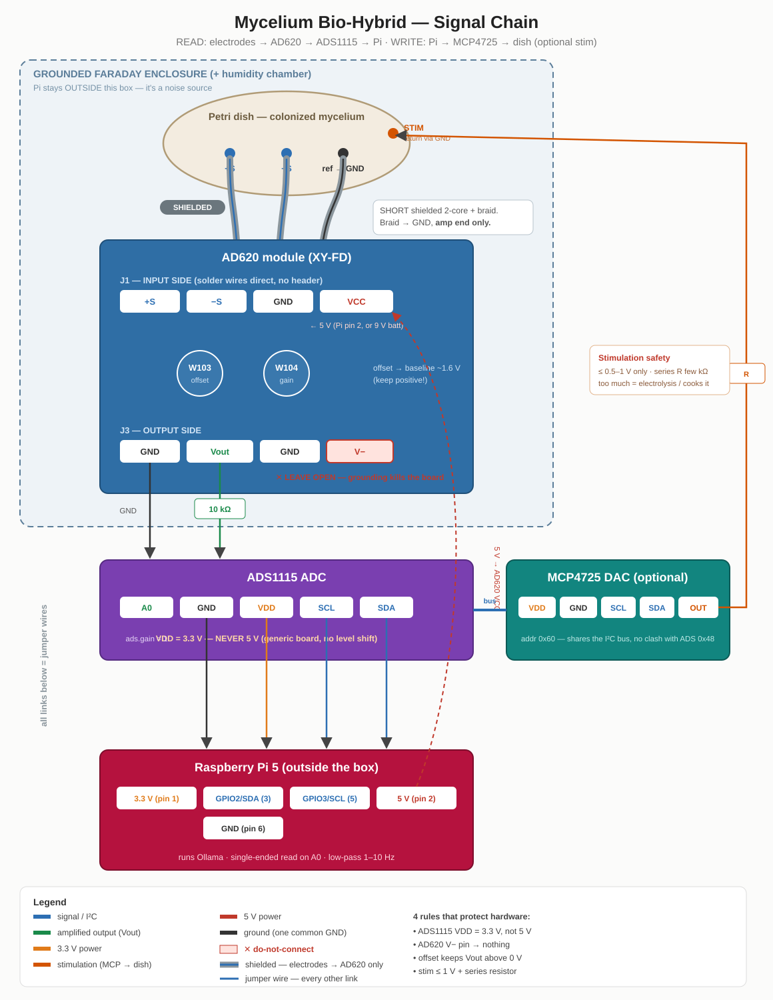

# Jimmy 1 — Mycelium x Raspberry Pi Bio-Hybrid

<p align="left">
  <a href="https://www.youtube.com/@SliderLab"></a>
  <a href="https://github.com/sponsors/slider-labs0"></a>
  <a href="https://sliderlabs.dev/"></a>
</p>

A living oyster-mushroom network wired into a local language model running on a
Raspberry Pi 5. Electrodes read the mycelium's electrical activity, an amplifier
and ADC digitize it, and those numbers steer a small LLM's randomness and tone.
The project also adds a stimulation path so the network can be electrically
poked and its reaction measured.

## What is and is not happening

The Raspberry Pi does all the computation in silicon. The mushroom does not run
the language model, does not do math, and does not "think." The mushroom produces
a real electrical signal. That signal is turned into a few numbers that bias the
model. The relationship is influence, not computation.

## Circuit map



Full wiring tables are in `docs/tutorial.md`; the AD620 pinout is in `docs/materials.md`.

## Results

All numbers below are measured, not estimated. Scripts and raw summaries are in
this repo.

**Noise floor (amplifier inputs shorted, no mushroom):**
- std dev: 2.79 mV
- peak-to-peak: 33.5 mV
- 6869 samples over 5 minutes, zero I/O errors

**Passive signal, 1-hour untouched runs, same conditions:**

| | Wet paper towel (control) | Live mushroom |
|---|---|---|
| events | 0 | 60 |
| std dev | 7.2 mV | 41.7 mV |
| peak-to-peak | 54 mV | 151 mV |
| biggest event | n/a | 18.3 mV |

The dead control produced zero events. The living plate produced sixty, all in
the tens-of-millivolts range where fungal signals live, arriving in bursts with
quiet gaps. The gap between the two is the result.

**Stimulation (0.82 V pulses, live plate vs dead substrate):**
The live plate showed large early spike increases after pulses (+12, +16, +38,
+49) that faded with repeated stimulation. The dead control never cleared +2 and
had a flat baseline. The living network responds to stimulation in a way dead wet
substrate does not.

## Repo layout

```
.
├── README.md
├── docs/
│   ├── circuit-map.svg       wiring diagram
│   ├── materials.md          full bill of materials
│   ├── tutorial.md           step-by-step build and run
│   └── troubleshooting.md    every bug hit and its fix
├── src/
│   ├── read_test.py          live single-channel voltage read
│   ├── noise_floor.py        5-minute baseline, std dev + peak-to-peak
│   ├── long_record.py        long run with event detection
│   ├── calibrate.py          measure a plate's spike/spread range
│   ├── mushroom_llm.py       signal -> LLM temperature + mood
│   ├── stim_test.py          bench-test DAC output voltage before it touches tissue
│   └── stim_loop.py          stimulate -> read -> LLM response loop
└── data/
    └── results.md            recorded run summaries
```

## Quick start

1. Build the hardware per `docs/materials.md` and `docs/tutorial.md`.
2. On the Pi: enable I2C, install libraries, confirm `i2cdetect -y 1` shows the
   ADS1115 at 0x48.
3. Short the amplifier inputs and run `noise_floor.py` to get your baseline.
4. Put electrodes in a live colonized plate, run `long_record.py`, compare to a
   dead-plate control.
5. Run `mushroom_llm.py` to drive the model from the live signal.

Full detail is in `docs/tutorial.md`.

## A note on honesty

The model writes vivid, specific text. None of that comes from the mushroom. The
mushroom contributes a spike count and a spread value that set the temperature and
a mood word. The eloquence is the language model. The biology is a dial. Every
claim in this repo is backed by a dead-substrate control, because a wet electrode
on its own produces most of the raw signal and only the controlled comparison
separates biology from artifact.

Built for learning, research, and art. Not a medical or safety-critical device.
